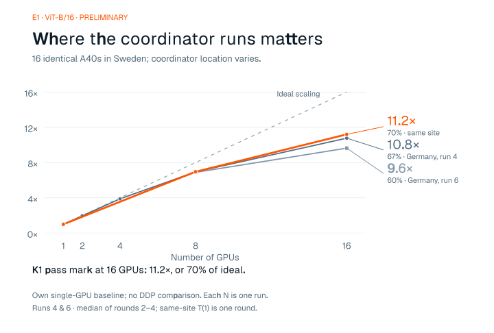
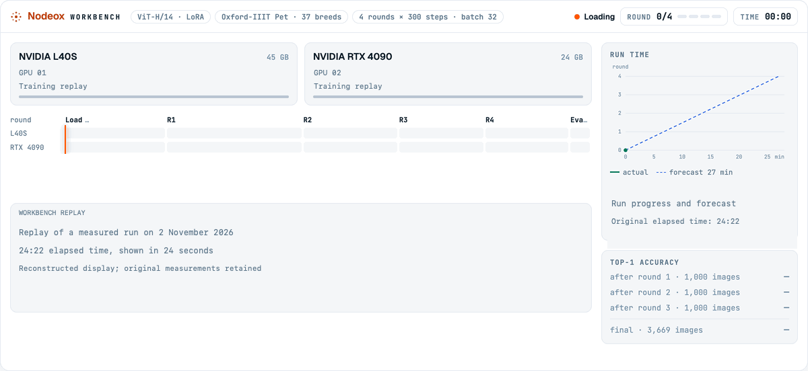

# Nodeox E1-A benchmark

How much can extra GPUs shorten a training round—and can NVIDIA and AMD GPUs train one model together without a large accuracy gap?

Nodeox is an execution layer that lets a training job use GPUs of different generations and vendors together.

We’re sharing these measurements so you can inspect the evidence behind our early results: what we tested, how we calculated the figures, and where the results fall short. This repository contains selected measurements and the calculation script. To learn more about the Nodeox platform, visit [nodeox.com](https://nodeox.com).

These October 2026 experiments tested those questions separately. Inspect 13 measurement extracts and recalculate the results with Python. **No GPU or Nodeox account required.**

## Results at a glance

**ViT-B/16, preliminary.** Both tests fine-tuned Google's pretrained ViT-B/16 on Oxford-IIIT Pet: 3,680 trainval images and a final evaluation on 3,669 test images across 37 breeds.

| Question | Setup | Result |
|---|---|---|
| How does round time scale? | 1, 8 and 16 identical NVIDIA A40s; coordinator and GPUs in one datacenter; 16–17 October 2026 | At 8 GPUs: **128.266 s, 6.96×, 87% efficiency**. At 16 GPUs: **79.732 s, 11.2×, 70% efficiency**. Both use the one-GPU baseline of 893.143 s. |
| Does a mixed-vendor run reach similar accuracy? | NVIDIA A40 + RTX 4090 + AMD MI300X, compared with two controls using 3 × A40 each; 14 October 2026 | Mixed: **93.08%**. NVIDIA-only controls: **93.40%** and **93.51%**. Gap from their mean: **0.38 percentage points**. |

The same-site one-GPU baseline contains **one measured post-warm-up round**. The multi-GPU times are medians of rounds 2–4.

With the coordinator on our server in Germany, reached over the internet, the same 16 A40s reached **60–67% efficiency on two nights**, below the 70% mark; the pass came only with the coordinator inside the GPUs' datacenter.

## Quick start

Install Python 3.9 or later, then:

```bash
git clone https://github.com/nodeoxai/e1-benchmark.git
cd e1-benchmark
python3 recalculate.py --check expected/results.json
```

The calculation uses only Python's standard library. After cloning, it runs offline and ends with:

```text
Check passed: every value matches expected/results.json.
```

This recalculates recorded measurements; it does not rerun training. Model weights, dataset images and the Nodeox platform are not bundled here.

## Scaling: coordinator placement matters



The same-datacenter series uses its 893.143 s one-GPU time. Both Germany series use the 13–14 October one-GPU time of 906.670 s; there was no new Germany one-GPU baseline on the second night. The chart includes the below-target configurations.

## Methods and limits

### Round-time scaling

The workload used full fine-tuning, batch 128, a configured total of 740 training steps per round across the participating GPUs, and seed 42. Round 1 was a warm-up.

- Speed-up = one-GPU round time / N-GPU round time.
- Scaling efficiency = speed-up / number of GPUs.
- At 16 GPUs in one datacenter: 893.143 / 79.732 = 11.2018135755; efficiency = 70.0113%.

The 16-GPU result sits at the predefined 70% threshold with a limited one-GPU baseline. Round duration includes coordination and exchange; it is not submission-to-result time. The comparison is against Nodeox's own one-GPU run, not PyTorch DDP or another multi-GPU framework.

### Mixed-vendor accuracy

The mixed run used GPUs in three sites (Sweden, Iceland and Atlanta), coordinated over the internet from Germany. The two controls each used three NVIDIA A40s. All three runs used full fine-tuning, batch 32, eight rounds, 240 configured total training steps per round, and seed 42. Final top-1 accuracy was evaluated on all 3,669 test images.

The absolute gap is calculated from unrounded final values:

| Run | Accuracy |
|---|---:|
| NVIDIA-only control A | 93.40419732897247% |
| NVIDIA-only control B | 93.51321886072499% |
| A40 + RTX 4090 + MI300X | 93.0771327337149% |
| Absolute gap from the controls' mean | 0.3815753611338266 percentage points |

The predefined tolerance was max(0.5 percentage points, the difference between the controls); both controls also had to reach at least 90%. This mixed run met those criteria. One mixed run and two controls do not establish accuracy variance across repeated experiments.

The accuracy test is separate from the identical-A40 scaling test. Together they do not establish a mixed-fleet speed-up. Larger-model results, customer queue-time reductions and cost savings require separate evidence. This release covers E1-A, measured in October 2026. Later studies will keep their own methods and records.

### Inspect the calculation

- [REPRODUCE.md](REPRODUCE.md): expected output, baselines and claim-to-record mapping.
- [data/README.md](data/README.md): extract schema, workloads and field selection.
- [MANIFEST.csv](MANIFEST.csv): the 13 records and their SHA-256 hashes.
- [expected/results.json](expected/results.json): the values checked by the command.

Missing records or rounds and incomplete final evaluations stop the calculation with an error. The full training implementation is outside this evidence package.

## Workbench replay



A separate product demonstration from **2 November 2026**: ViT-H/14 + LoRA on Oxford-IIIT Pet, using NVIDIA L40S and RTX 4090 GPUs. The measured run lasted 24:22 and finished at 90.5% top-1 accuracy on 3,669 images; this reconstructed replay lasts 24 seconds. Accuracy after rounds 1–3 uses a 1,000-image subset; the final value uses all 3,669 test images. Timeline phase proportions were reconstructed for display. Machine identifiers and detailed execution and exchange logs are omitted.

This is not a screen recording or an E1-A benchmark run. Its measurements are not included in the 13-record calculation package.

## Read more

- [How to benchmark mixed-GPU training without fooling yourself](https://nodeox.com/blog/benchmark-mixed-gpu-training)
- [What kept GPUs waiting: an E1 study of distributed training overhead](https://nodeox.com/blog/e1-distributed-training-overhead)
- [Oxford-IIIT Pet dataset](https://www.robots.ox.ac.uk/~vgg/data/pets/)

These field-selected measurement extracts support the round-time and accuracy calculations; complete event logs and per-phase exchange analysis are outside this release.

Nodeox maintains this repository. Found a discrepancy in a record or calculation? Email [info@nodeox.com](mailto:info@nodeox.com) with the file, command and output. We'd also like to hear which comparison you found useful.

## Licences

The calculation code is [MIT-licensed](LICENSE). The measurement records are [CC BY 4.0](data/LICENSE), attributed as "Nodeox E1 benchmark records, nodeox.com". Those terms do not cover the original model, dataset or Workbench visual assets. Third-party model and dataset sources are linked in [data/README.md](data/README.md).
